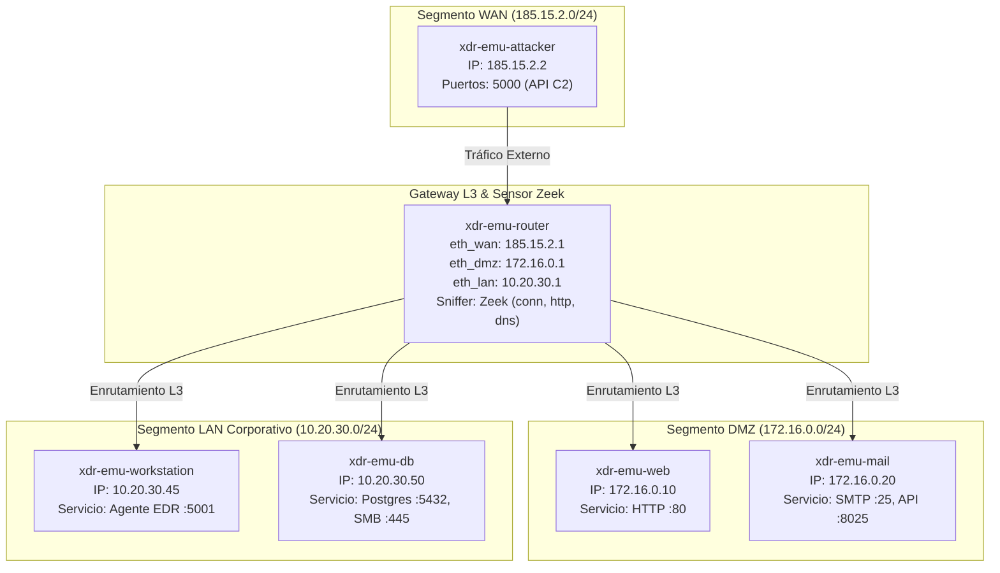
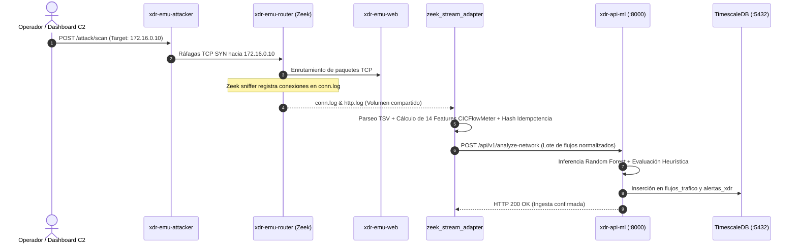

# Módulo de Emulación y Cyber Range XDR

Bienvenido a la documentación oficial del entorno de **Emulación de Red y Cyber Range** de la plataforma XDR.

Este módulo reemplaza los antiguos inyectores de telemetría sintética por una **red virtual de dispositivos reales** que interactúan mediante tráfico TCP/IP genuino a través de switches virtuales y un router Layer 3 instrumentado con el sensor pasivo Zeek.

---

## 1. Filosofía Arquitectónica y Desacoplamiento

El principio rector de este módulo es la **separación estricta de responsabilidades**:

```
+----------------------------------------------------------------------------------------------------+
|                                    PLATAFORMA XDR (SOC / SIEM)                                     |
|  - API de Ingesta y ML (api-ml:8000)                                                               |
|  - Base de Datos Forense (TimescaleDB:5432)                                                        |
|  - Motor de Correlación y Topología (api-topology:8002)                                            |
|  - Frontend de Visualización de Incidentes (xdr-dashboard:3000)                                    |
+----------------------------------------------------------------------------------------------------+
                                                  ^
                                                  | Telemetría Estándar (ZeekLog, SysmonLog, EmailLog)
                                                  | Ingesta Streaming
+----------------------------------------------------------------------------------------------------+
|                             PIPELINE DE INGESTA (pipeline_ingesta)                                 |
|  - zeek_stream_adapter: Lee conn.log/http.log, calcula 14 CICFlowMeter + 17 ML y despacha al XDR   |
+----------------------------------------------------------------------------------------------------+
                                                  ^
                                                  | Logs en Vivo (/zeek_logs)
+----------------------------------------------------------------------------------------------------+
|                                 CYBER RANGE (topologias / dispositivos)                            |
|  - Red física virtual segmentada en 3 switches L2 (WAN, DMZ, LAN)                                  |
|  - Gateway L3 con reenvío IP y Zeek sniffer                                                        |
|  - Contenedores independientes para cada dispositivo (Attacker, Web, Mail, Workstation, DB)        |
|  - Dashboard C2 (:9000) para orquestar ataques reales entre hosts                                  |
+----------------------------------------------------------------------------------------------------+
```

### ¿Por qué esta arquitectura es superior al mocking tradicional?
1. **Fidelidad Experimental:** Los modelos de Machine Learning (Random Forest de Capa de Red) procesan estadísticas de flujo derivadas de paquetes reales y no números inventados.
2. **Descubrimiento Autónomo de Topología:** El microservicio `api-topology` mapea la red a partir de las direcciones IP observadas en los flujos capturados por Zeek (`get_or_create_device`).
3. **Correlación Verídica:** Los incidentes multi-vector (Red + Endpoint) se correlacionan porque ocurrieron físicamente en las marcas temporales y direcciones de red reales.
4. **Eficiencia frente a GNS3:** Toda la red compleja corre en contenedores ligeros sobre Docker, consumiendo **menos de 450 MB de RAM** en contraste con los 8-16 GB que requeriría virtualizar máquinas completas en GNS3.

---

## 2. Diagramas de Funcionamiento

### A. Diagrama de Topología y Enrutamiento (Capa 2 y Capa 3)



### B. Diagrama de Secuencia: Flujo de Ingesta en Tiempo Real



---

## 3. Estructura del Directorio

```text
emulation/
│
├── dashboard/                             # Panel de Control y Orquestador C2 (:9000)
│   ├── main.py                            # FastAPI que traduce clics web a órdenes para los contenedores
│   ├── templates/index.html               # Frontend visual con consola de estado
│   ├── Dockerfile                         # Imagen del dashboard
│   ├── requirements.txt                   # Dependencias mínimas
│   └── test_dashboard_orchestrator.py     # Pruebas unitarias de orquestación
│
├── dispositivos/                          # Biblioteca de Plantillas de Dispositivos Modulares
│   ├── base/Dockerfile                    # Imagen base común con stack de red Linux
│   ├── attacker/                          # Contenedor ofensivo (nmap, hping3, scapy, control :5000)
│   ├── server-web/                        # DMZ Web Server (HTTP :80 + Hook EDR)
│   ├── server-mail/                       # DMZ Mail Server (SMTP :25 + Extractor 24 features EmailLog)
│   ├── workstation/                       # PC cliente corporativo (Agente Sysmon :5001 + sim. tráfico)
│   ├── server-db/                         # Base de Datos protegida (Listeners TCP :5432 y :445)
│   ├── router-sensor/                     # Gateway L3 con motor de captura Zeek en vivo
│   ├── test_device_units.py               # Suite de pruebas unitarias de dispositivos
│   └── test_devices.ps1                   # Script de compilación aislada en Docker
│
├── pipeline_ingesta/                      # Puente de Telemetría Streaming hacia el Core XDR
│   ├── zeek_stream_adapter.py             # Daemon tailing continuo, CICFlowMeter y despacho batch
│   ├── Dockerfile                         # Contenedor del worker de ingesta
│   ├── test_pipeline_deep.py              # Suite de 7 pruebas rigurosas de streaming y resiliencia
│   └── README.md                          # Documentación del pipeline
│
├── topologias/                            # Definición de Redes y Escenarios
│   └── red-corporativa-base/              # Topología Principal (WAN + DMZ + LAN)
│       ├── docker-compose.yml             # Manifiesto Compose de la red completa
│       ├── setup_routes.ps1 / .sh         # Scripts para validar/establecer enrutamiento
│       ├── verify_topology.ps1            # Verificador automatizado de saltos de red
│       └── README.md                      # Mapa de direccionamiento de la topología
│
└── validation_infrastructure/             # Evidencia y reportes de validación de ingeniería
```

---

## 4. Catálogo de Dispositivos Emulados

| Dispositivo | Hostname / IP | Red L2 | Puertos Expuestos | Rol y Funcionalidad |
| :--- | :--- | :--- | :--- | :--- |
| **`attacker`** | `KALI-ATTACKER`<br>`185.15.2.2` | `net-wan` | `5000/tcp` (API Control) | Ejecuta escaneos `nmap`, ráfagas `hping3`, exploits web y envío de phishing por SMTP. |
| **`router-sensor`** | `EMU-GATEWAY`<br>`185.15.2.1`<br>`172.16.0.1`<br>`10.20.30.1` | `net-wan`<br>`net-dmz`<br>`net-lan` | Interfaces en modo promiscuo | Router central (`ip_forward=1`). Sniffing Zeek en vivo con salida a `/zeek_logs`. |
| **`server-web`** | `SRV-DMZ-WEB`<br>`172.16.0.10` | `net-dmz` | `80/tcp` (HTTP) | Servidor web corporativo. Expone endpoint vulnerable `/api/vulnerable-exec` instrumentado con hook EDR. |
| **`server-mail`** | `CORP-MAIL-EXCHANGE`<br>`172.16.0.20` | `net-dmz` | `25/tcp` (SMTP)<br>`8025/tcp` (API Diagnóstico) | Servidor SMTP real. Al recibir emails, analiza cabeceras, enlaces y adjuntos emitiendo `EmailLog`. |
| **`workstation`** | `VENTAS-PC`<br>`10.20.30.45` | `net-lan` | `5001/tcp` (API Agente) | PC de empleado. Emite telemetría Sysmon EventID 1 (Mimikatz) y simula navegación web periódica. |
| **`server-db`** | `SRV-DB-INTERNAL`<br>`10.20.30.50` | `net-lan` | `5432/tcp` (PostgreSQL)<br>`445/tcp` (SMB)<br>`8050/tcp` (Diagnóstico) | Servidor de base de datos interno. Registra intentos de acceso lateral este-oeste. |

---

## 5. Guía de Ejecución y Pruebas Paso a Paso

Las pruebas se dividen en **3 niveles de verificación**, desde pruebas unitarias offline hasta la ejecución integral en vivo.

### Nivel 1: Pruebas Unitarias de Lógica y Esquemas (Offline / Sin Docker)

Estas pruebas no requieren que Docker Desktop esté encendido; verifican la integridad algorítmica, parsers y contratos de datos:

#### 1. Prueba de Esquemas y Dispositivos:
```bash
python emulation/dispositivos/test_device_units.py
```
* **Qué valida:** Generación de Sysmon EventID 1 con hashes SHA-256, extracción de las 24 características de `EmailLog` a partir de un email MIME real, sintaxis AST de las APIs de control.
* **Resultado esperado:**
  ```text
  Ran 5 tests in 0.387s
  OK
  ```

#### 2. Prueba Profunda del Pipeline de Ingesta Streaming:
```bash
python emulation/pipeline_ingesta/test_pipeline_deep.py
```
* **Qué valida:** Parseo dinámico TSV con directivas Zeek, cálculo exacto de las 14 métricas CICFlowMeter, correlación en memoria de HTTP por UID, lectura incremental por offsets, detección automática de rotación/truncamiento, transmisión a servidor mock y retroceso exponencial ante errores HTTP 503.
* **Resultado esperado:**
  ```text
  Ran 7 tests in 1.648s
  OK
  ```

#### 3. Prueba del Orquestador Dashboard C2:
```bash
python emulation/dashboard/test_dashboard_orchestrator.py
```
* **Qué valida:** Mapeo de los 5 botones del panel web a peticiones de control dirigidas a los contenedores respectivos.
* **Resultado esperado:**
  ```text
  Ran 5 tests in 0.367s
  OK
  ```

---

### Nivel 2: Despliegue de la Red y Verificación de Conectividad (Docker)

#### Opción A: Despliegue Global Unificado (Recomendado)
Puedes levantar tanto la Plataforma XDR como el Cyber Range con un solo comando desde la raíz del proyecto:
```powershell
# Iniciar todo normalmente conservando historial:
powershell -ExecutionPolicy Bypass -File .\start_all.ps1

# Iniciar todo con reseteo limpio (0 alertas, 0 nodos residuales):
powershell -ExecutionPolicy Bypass -File .\start_all.ps1 -Clean
```
Para apagar todo el entorno:
```powershell
powershell -ExecutionPolicy Bypass -File .\stop_all.ps1
```
Para limpiar la base de datos y la caché en cualquier momento sin apagar los servicios:
```powershell
powershell -ExecutionPolicy Bypass -File .\reset_db.ps1
```

#### Opción B: Despliegue Manual por Módulos
1. **Iniciar Plataforma XDR:**
   ```bash
   docker compose up -d
   ```
2. **Iniciar Cyber Range (Red Corporativa Emulada + Pipeline de Ingesta):**
   ```bash
   docker compose -f emulation/topologias/red-corporativa-base/docker-compose.yml up -d
   ```


#### 3. Verificar Conectividad y Rutas Inter-Segmento:
En PowerShell:
```powershell
powershell -ExecutionPolicy Bypass -File emulation/topologias/red-corporativa-base/verify_topology.ps1
```
* **Qué evalúa:**
  - Que los 6 contenedores principales estén activos.
  - Que el atacante (`185.15.2.2`) pueda hacer ping y HTTP a la DMZ (`172.16.0.10`).
  - Que la Workstation (`10.20.30.45`) pueda navegar hacia la DMZ (`172.16.0.10`).
  - Que la Workstation alcance la base de datos interna (`10.20.30.50`).
  - Que el proceso `zeek` esté ejecutándose en `xdr-emu-router`.
* **Resultado esperado:** Los 5 chequeos en estado `[OK]`.

---

### Nivel 3: Disparo de Escenarios desde el Dashboard C2

Una vez levantada la red, abre tu navegador en:
👉 **`http://localhost:9000`** (Panel C2)  
👉 **`http://localhost:3000`** (Frontend XDR - Topología y Alertas)

#### Escenario A: Generar Tráfico Legítimo
* **Acción en C2:** Clic en **"Generar Tráfico Normal"**.
* **Mecanismo:** La Workstation (`10.20.30.45`) emite un `GET http://172.16.0.10/`.
* **Resultado en Red:** Zeek registra la conexión con estado `SF` y servicio `http`.
* **Resultado en XDR:** El adaptador ingesta el flujo; el modelo de ML lo clasifica con baja probabilidad de anomalía (`prob_red < 0.10`). En la vista de Topología (`:3000`), el enlace entre `10.20.30.45` y `172.16.0.10` se dibuja en verde (seguro).

#### Escenario B: Ataque de Reconocimiento de Red
* **Acción en C2:** Clic en **"Lanzar Ataque de Red"**.
* **Mecanismo:** El Atacante (`185.15.2.2`) ejecuta escaneo de puertos SYN y ráfagas contra `172.16.0.10:80`.
* **Resultado en Red:** Decenas de paquetes SYN incompletos (`conn_state: S0`, flags `history: S`) atraviesan el router.
* **Resultado en XDR:** El adaptador calcula alta tasa de paquetes (`Flow_Packets_s`), el modelo Random Forest o la heurística volumétrica elevan la anomalía (`prob_red = 0.99`). Se genera una alerta de severidad Alta/Crítica en la tabla `alertas_xdr`.

#### Escenario C: Infección de Endpoint (EDR)
* **Acción en C2:** Clic en **"Infectar Endpoint"**.
* **Mecanismo:** La Workstation ejecuta la simulación de malware fileless (`powershell.exe -enc ... mimikatz`).
* **Resultado en XDR:** Se genera telemetría Sysmon EventID 1 hacia `/api/v1/analyze-endpoint`. El modelo NLP/TF-IDF detecta el comando malicioso y genera alerta de vector Endpoint.

#### Escenario D: Campaña de Phishing
* **Acción en C2:** Clic en **"Enviar Phishing"**.
* **Mecanismo:** El atacante abre conexión SMTP al puerto 25 de `172.16.0.20` e inyecta un correo con dominios de phishing y adjunto sospechoso.
* **Resultado en XDR:** `server-mail` procesa el correo, extrae las 24 características y las transmite a `/api/v1/analyze-email`. El modelo clasifica el correo como malicioso y genera alerta de vector Email.

#### Escenario E: Movimiento Lateral (Correlación Multi-Vector Completa)
* **Acción en C2:** Clic en **"Ejecutar Movimiento Lateral"**.
* **Mecanismo:**
  1. **Paso 1:** Exploit HTTP de `185.15.2.2` a `172.16.0.10:80`.
  2. **Paso 2:** Hook EDR en `SRV-DMZ-WEB` registra ejecución sospechosa de `w3wp.exe -> cmd.exe`.
  3. **Paso 3:** Conexión este-oeste desde DMZ hacia `10.20.30.50:445` (SMB).
* **Resultado en XDR:**
  - El motor de correlación temporal (`correlation_service.py`) vincula la alerta de red inicial, la alerta de endpoint en la DMZ y el flujo SMB lateral bajo un **mismo incidente correlacionado** (`id_evento_correlacionado`).
  - En el mapa de topología (`:3000`), se visualiza el grafo de ataque (*attack flow*) unificado conectando los 3 nodos.

---

## 6. Creación de Nuevas Topologías Personalizadas

El diseño modular permite crear fácilmente redes adicionales sin modificar el código de los dispositivos:

1. Crea una nueva subcarpeta en `emulation/topologias/mi-nueva-red/`.
2. Escribe un archivo `docker-compose.yml` reutilizando las plantillas de `../../dispositivos/`:
   ```yaml
   services:
     mi-servidor:
       build: ../../dispositivos/server-web
       networks:
         mi-vlan:
           ipv4_address: 192.168.10.5
   networks:
     mi-vlan:
       driver: bridge
       ipam:
         config:
           - subnet: 192.168.10.0/24
   ```
3. Levanta tu nueva topología con `docker compose up -d`.

### Integración con GNS3 / EVE-NG
Si deseas conectar un laboratorio completo de GNS3 a este XDR:
1. Conecta un nodo **Cloud** de GNS3 a la interfaz de red del host donde corre Docker.
2. Coloca un sensor Zeek en tu topología de GNS3 exportando logs a una carpeta compartida.
3. Ejecuta `zeek_stream_adapter.py` apuntando a dicha carpeta:
   ```bash
   python emulation/pipeline_ingesta/zeek_stream_adapter.py --log-dir /ruta/a/gns3/zeek_logs
   ```
El XDR ingerirá y dibujará automáticamente la topología de GNS3 sin tocar una sola línea de código del backend.

---

## 7. Detener el Entorno de Emulación

Para apagar la topología y liberar recursos:
```bash
docker compose -f emulation/topologias/red-corporativa-base/docker-compose.yml down
```
Para limpiar volúmenes de logs acumulados:
```bash
docker compose -f emulation/topologias/red-corporativa-base/docker-compose.yml down -v
```
